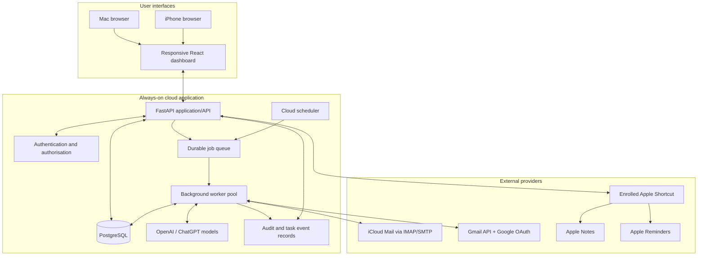
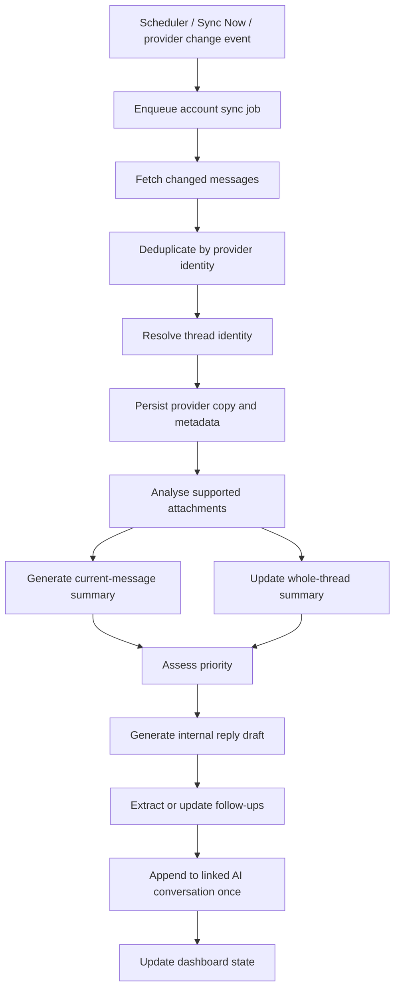

# Email Assistant — System Architecture

**Architecture version:** 1.1  
**Status:** Approved direction for implementation  
**Product:** Private, cloud-hosted email workspace and AI task assistant

## 1. Product boundaries

- One cloud backend runs email synchronisation and delegated AI task execution.
- One responsive dashboard is accessible from Mac and iPhone.
- The user's browser, Mac, and open ChatGPT conversation are not required for cloud email processing or ordinary delegated tasks to continue.
- Native Apple Notes and Reminders creation is a device-side exception: the cloud queues an authenticated command, and an enrolled Apple Shortcut on an available Mac/iPhone executes it.
- No push, email, WhatsApp, SMS, desktop, or other proactive notification delivery.
- Initial mailbox import is the most recent 90 days per account; older mail is retrieved on demand where provider APIs permit.
- Supported mail providers: multiple iCloud Mail accounts and multiple Gmail accounts.
- AI preference: ChatGPT/OpenAI models, using supported OpenAI API or eligible ChatGPT Apps integration. The application must disclose API billing separately if API use is selected.

## 2. High-level architecture

## 3. Application components

### Frontend
- React + TypeScript responsive web interface.
- Four main areas: Inbox, Follow-ups, AI Assistant, Accounts & Settings.
- Three-column desktop Inbox; responsive email list/detail flow on mobile.
- All sensitive actions call authenticated backend APIs. The frontend never receives provider passwords, refresh tokens, or OpenAI secrets.

### API/backend
- Python + FastAPI.
- Authenticates users and devices, validates requests, applies permission rules, and orchestrates application modules.
- Modules: account management, provider adapters, message sync, duplicate detection, thread resolver, summary/draft generation, priority, attachments, follow-ups, AI tasks, Apple command queue, audit and settings.

### Database
PostgreSQL is the durable source of truth for application state.

Core entities/tables:
- users, sessions, authorised_devices
- email_accounts, provider_tokens/secret references
- messages, provider_message_copies, attachments
- threads, cross_account_duplicate_groups
- ai_summaries, ai_drafts, draft_versions
- ai_conversations, email_thread_ai_links, ai_conversation_items
- follow_ups, follow_up_events
- delegated_tasks, delegated_task_steps, task_events, idempotency_records
- apple_commands, apple_command_attempts
- sync_cursors, sync_runs, audit_events
- account_review_schedules, user_preferences

Do not store raw provider credentials or OpenAI API keys in ordinary database rows. Use encrypted secret storage or a managed secret manager and store only secret references in the database.

### Durable job queue and background worker
- Use a durable queue backed by PostgreSQL or a managed queue service.
- A cloud scheduler enqueues account sync jobs at the configured times (default 08:00, 12:00, 17:00 Asia/Kolkata).
- Manual Sync Now enqueues the same idempotent sync pipeline.
- Gmail change notifications can enqueue incremental sync jobs; iCloud may use IMAP IDLE if supported by the chosen server/connection, with polling fallback.
- Worker processes jobs independently of browser/ChatGPT session state.
- Delegated AI tasks are persisted and scheduled as jobs, not held in an in-memory request or browser session.
- A worker orchestrates discrete steps and invokes the OpenAI model when needed. The OpenAI model itself is not assumed to be a continuously running worker.
- Jobs are checkpointed. They can safely resume after process restart or deployment.
- Use idempotency keys, deduplication, bounded retries, exponential backoff, and a dead-letter/failed state.
- Long jobs must have timeouts and step limits. Human approval or missing information moves a job to Waiting for User.

## 4. Email provider adapters

### iCloud Mail
- Connect using the supported IMAP/SMTP path and an Apple app-specific password.
- Store the app-specific password in deployment secret storage.
- Use IMAP UIDs and RFC Message-ID where available for identity/deduplication.
- Verify IMAP IDLE capability before relying on it; otherwise poll.
- Read/unread, move-to-trash, drafts and send operations must be checked against provider response.

### Gmail
- Use Gmail API and Google OAuth, not the user's Google password.
- Store OAuth refresh tokens securely server-side.
- Use Gmail thread IDs, message IDs and history IDs for incremental synchronisation.
- Google watch/Pub/Sub may be used for change detection, with scheduled renewal and polling/repair sync as a fallback.
- Request only required OAuth scopes and complete Google's OAuth verification/production process as applicable.

### Provider-neutral message model
- Each mailbox copy has its own provider/account identity and state.
- Same email copies can be visually grouped only when high-confidence duplicate identity is established.
- Grouping does not combine read state, deletion, flags or provider operations.
- Actions from a visually grouped card are scoped to the selected account copy unless the user explicitly requests a multi-account action.

## 5. Sync and AI processing pipeline

- First import covers the last 90 days per account and is resumable.
- Older mail can be fetched on demand.
- Incremental sync uses provider cursors/history after the initial import.
- Background summarisation, attachment analysis or draft generation does not mark an email read.
- Opening an email detail in the portal marks that exact source copy read in its provider; provider confirmation is required.
- Provider-side read changes are reflected at the next sync.
- Each incoming email gets a current-message summary, separate whole-thread summary, priority assessment and an internal draft record (or explicit "reply not recommended" state).
- AI must be grounded in retrieved content; missing/truncated data must be disclosed.

## 6. Persistent AI conversations and automatic email trail updates

- Application-managed AI conversations use supported OpenAI conversation-state APIs.
- Database maps provider + account + thread identity to the relevant OpenAI Conversation ID.
- On every new message in a linked thread, a worker verifies identity, prevents duplicates, appends the new email context once and triggers summary/task reassessment.
- AI conversations in this application are not represented as arbitrary native ChatGPT history conversations. Native ChatGPT history modification must not be claimed without a supported product integration.

## 7. Delegated AI task execution

### Durable task lifecycle
- User assigns a task in the AI Assistant.
- API validates the request and creates a durable task record with a unique ID, scope, linked email/thread references, status, and plan/steps.
- Task scheduler enqueues the task.
- Background worker claims the job, records a lease/heartbeat, and executes each approved step.
- After each step, the worker persists checkpoint, result reference, status and updated progress.
- User closing the dashboard, browser, or related ChatGPT conversation does not cancel or pause the task.
- Worker restart/deploy does not lose progress. Expired leases are safely reclaimed.
- User can return from another device and see saved status and task updates.

### Task states
- Queued
- In Progress
- Waiting for User
- Completed
- Failed
- Cancelled

### Execution safeguards
- Each step has idempotency key and retry policy.
- Use bounded retries with backoff; permanent errors move to Failed with actionable explanation.
- If user input, account reconnect or approval is needed, move to Waiting for User and save a resumable checkpoint.
- Sending email, permanent deletion, sender blocking changes and other consequential actions pause for required approval.
- User can pause/cancel eligible tasks.
- Never fabricate progress. Only report persisted worker status and completed steps.
- No proactive notifications. The dashboard displays task changes when opened/refreshed.

## 8. Apple Notes and Reminders bridge

- Cloud parses natural-language reminder/note instruction and stores an authenticated, device-targeted Apple command.
- If no authorised device is available, leave it Pending on Device.
- An enrolled Mac/iPhone Shortcut polls/receives eligible commands, validates one-time credentials, performs native Apple action and returns a signed/validated result.
- Mark Completed only after confirmed Shortcut result.
- Commands are idempotent to prevent duplicate notes/reminders.
- Cloud task execution can continue while device is offline, but native Apple action cannot complete until a compatible device runs the Shortcut.

## 9. Security boundaries

- HTTPS, authentication, secure sessions and least-privilege access.
- OAuth tokens and app-specific passwords stored in a managed secret manager.
- Encryption at rest and in transit; database access restricted to the application.
- Restrict CORS to production dashboard origin.
- CSRF protection for state-changing browser operations.
- Safe rendering of untrusted email HTML and attachments.
- AI instructions embedded in email content must never override app/system instructions.
- No secrets or message bodies in source control or routine logs.
- Require approval for consequential operations.
- Record action/task audit metadata without retaining unnecessary message contents.
- Private dashboard; no public registration in initial version.

## 10. Proposed implementation sequence

1. Consolidate requirements and API contracts.
2. Backend skeleton, database migrations, authentication and secrets.
3. Deploy private dashboard and API.
4. Implement iCloud and Gmail account connections.
5. Implement initial 90-day import and incremental sync.
6. Implement unified inbox, provider state reconciliation and attachments.
7. Implement OpenAI summaries, priority, internal drafts and persistent AI conversations.
8. Implement follow-ups and durable delegated task worker.
9. Implement email action endpoints and approval gates.
10. Implement Apple Shortcut bridge.
11. Add observability, recovery, rate limiting, security tests and end-to-end tests.

## 11. Task priority queue and bounded parallel execution — approved

- The task scheduler uses a priority-aware queue and a bounded worker pool.
- Run **up to three independent delegated AI tasks concurrently** for this user's workspace.
- This is a maximum concurrency limit, not a requirement to run three tasks at all times.
- Tasks with dependencies must execute in dependency order. A task step cannot start until its prerequisite steps are confirmed complete.
- Independent tasks may run in parallel, subject to the maximum of three active tasks.
- Tasks waiting for user input/approval, paused by the user, or waiting for an external Apple device do not occupy an active AI worker slot.
- The scheduler prioritises queued tasks by priority: Urgent, High, Normal, Low. Within the same priority, use FIFO ordering unless a valid due-time rule is explicitly configured.
- A higher-priority task may move ahead of queued lower-priority tasks, but must not abruptly interrupt a running step. Running tasks pause only at safe persisted checkpoints when necessary.
- Enforce per-user and provider/API rate limits, bounded retries, backpressure and fair scheduling. Do not exceed the concurrency cap to work around rate limits.
- The concurrency limit must be configurable by deployment operator for future capacity tuning, with **3** as this user's approved default.
- Surface queued position, task priority, active/queued state, dependencies, current step and persisted progress in the task UI.

## 11. AI task scheduling and worker concurrency — approved policy

### Approved concurrency
- Initial maximum: **three independent delegated AI tasks executing concurrently** across the user's workspace.
- Enforce the cap in the backend worker scheduler using a durable queue and database-backed task leases/semaphores. Never rely on frontend/browser state to enforce concurrency.
- Independent tasks may run at the same time while active slots are available.
- Tasks with dependencies are represented as a dependency graph or ordered steps and only become eligible after prerequisites succeed.
- Waiting-for-user tasks release their active worker slot; unrelated queued tasks may then proceed.
- Completed, cancelled and terminally failed tasks release their slots.
- Limit is operator-configurable for hosting/API cost management, with three as the approved initial setting.

### Priority-aware scheduling
- Persist a priority field on every task; default to Normal.
- Priority may be set by the user or by an explicit AI planning rule, and can be changed by the user.
- Select eligible queued work by priority first, then FIFO order within the same priority.
- Priority changes affect queued work only; do not pre-empt a running task in the initial implementation.
- Tasks at a higher priority still respect dependencies and the three-task concurrency cap.
- When all slots are occupied, additional tasks remain Queued with their priority and queue position visible.

### Reliability and visibility
- Persist queue state, lease/heartbeat, checkpoints, attempt count, last error and timestamps.
- Resume safely after worker restart or deployment.
- Use idempotency keys, bounded retries with backoff, and a clear terminal Failed state.
- Show active task slot usage and queued task count in the AI Assistant dashboard.
- No proactive notifications for task state changes.

## 12. AI task priority model — approved

### Priority values
Use a controlled enum:
- `urgent`
- `high`
- `normal`
- `low`

Default new tasks to `normal`.

### Assignment
- Store both `priority` and `priority_source` (for example: `user`, `ai_recommended`, `default`), plus an optional concise `priority_reason`.
- The AI may recommend Urgent or High only when supported by an explicit user instruction, a real due date, or clear task/business impact. Never invent a deadline.
- A user-set priority takes precedence over automatic reclassification until the user explicitly changes or resets it.
- Keep email priority and delegated-task priority as separate data fields and concepts.

### Scheduling
- Select eligible queued work by Urgent > High > Normal > Low.
- Use FIFO ordering within the same priority level.
- Respect dependencies and the global maximum of three concurrent tasks.
- Reordering applies to queued tasks only; do not pre-empt active work in the initial implementation.
- Tasks in Waiting for User do not consume a worker slot.
- Display the current priority, source, and reason in the dashboard when available.

## 13. Scheduled task start — approved

- Persist an optional `scheduled_start_at` timestamp for delegated AI tasks.
- A scheduler/worker marks a task eligible once its scheduled start time is reached; do not require a second user approval to begin the already-delegated task.
- Eligibility remains subject to dependency completion, worker capacity (global maximum 3), and the existing priority/FIFO queue policy.
- If capacity is unavailable at the scheduled time, retain the task in the durable queue; start it when a slot becomes available according to queue ordering.
- Scheduled-start permission is distinct from approval for consequential actions. Existing action-level approval gates remain in force.
- Record the scheduled time and actual start time for auditability. No notifications are emitted.

## 14. Automatic deadline-based priority escalation — approved

### Data and calculation
- Store the task's underlying `base_priority` separately from its calculated `effective_priority`.
- Store whether a user has explicitly overridden priority (for example, `priority_override_by_user`) and preserve the existing priority source/reason metadata.
- When the user has not manually overridden priority:
  - More than 72 hours remaining: use the base priority.
  - 72 hours or less remaining: effective priority is at least `high`.
  - 24 hours or less remaining: effective priority is `urgent`.
  - At or past the deadline: remain `urgent` until completion/cancellation or deadline change.
- Recalculate when the deadline changes and as time passes. If a deadline is extended, remove stale deadline escalation and recompute from the base priority and new remaining time.
- A user-set priority always wins. An explicit user command to restore Automatic clears the manual override and resumes deadline-based calculation.
- Do not infer or fabricate a deadline when none is supported by the task or user instruction.

### Scheduler integration
- Queue ordering uses `effective_priority`, followed by FIFO within the same priority.
- Deadline escalation does not pre-empt running tasks and does not override dependency, scheduled-start, concurrency, or consequential-action approval constraints.
- Calculate using timezone-aware timestamps; store consistently and display/interpret in the user's configured timezone (default Asia/Kolkata).
- Persist the reason for an escalated effective priority for audit and UI explanation.

## 15. Hard and target deadline model — approved

### Data model
- Add `deadline_type` enum: `hard` or `target`.
- Store `deadline_type_source` (for example `user`, `ai_classified`, `default`) and a concise `deadline_type_reason`.
- Store a supporting source/message reference when classification comes from an email or document.
- Default to `target` unless a user instruction or reliable source establishes a mandatory external obligation.
- Do not silently infer Hard from generic wording. Ask when the distinction materially affects handling and remains ambiguous.
- Allow the user to edit deadline date/time and type.

### Type-specific effective priority calculation
Apply only when the user has not manually overridden priority. Combine the escalation floor below with `base_priority`; never lower an existing base priority.

**Hard**
- More than 72 hours remaining: base priority.
- At 72 hours or less: at least `high`.
- At 24 hours or less: `urgent`.
- At or past deadline: remain `urgent` until completion/cancellation or deadline change.

**Target**
- More than 24 hours remaining: base priority.
- At 24 hours or less: at least `high`.
- At or past target time: remain at least `high` until completion/cancellation or target change.
- A target deadline alone cannot produce `urgent`.

Recalculate when time crosses a threshold and whenever the deadline, deadline type, or base priority changes. A user-set priority remains authoritative until reset to Automatic. Existing task eligibility, dependency, scheduled-start, concurrency, FIFO and consequential-action approval constraints remain unchanged.

## 16. Recurring task scheduling — excluded from initial scope

Do not implement recurrence rules, recurring-task scheduler triggers, or automatic generation of repeated task instances in the initial release. One-time scheduled starts and deadlines remain supported. Revisit only after an explicit future product decision.

## 17. AI integration, zero-cost operation and open-source release — approved direction

### AI provider path
- Preferred path: supported OpenAI Sign in with ChatGPT / ChatGPT plan usage integration for an open-source personal application, implemented only with the current official SIWC SDK and documentation.
- Verify the user's ChatGPT Go account eligibility and whether the exact deployment model is supported. Open-source status alone must not be treated as proof that a remotely hosted deployment is eligible.
- The app's own conversations and context live in its own database. SIWC plan usage does not provide access to native ChatGPT conversations or memories.
- Select only models exposed through the authorised SIWC integration. Do not promise parity with every model or ChatGPT product feature.
- No OpenAI API key or API-billed inference path is to be configured.

### SIWC credentials and background execution
- Use the official OAuth flow only. Never collect ChatGPT passwords or cookies.
- Do not put SIWC authentication tokens in PostgreSQL, a managed cloud secret manager, source control, logs, or environment files in the public repository.
- The current SIWC terms restrict persistent token storage to local storage under the user's control. OpenAI documents a separate self-hosted VM procedure; validate the exact VM ownership, credential location, transfer process, revocation/usage attribution limitations and current terms before using it.
- Because background mail analysis and delegated tasks must originate from the user's own expressly authorised activity, obtain an explicit user consent during setup for each enabled category of background AI processing and make the control revocable.
- If the intended cloud runtime cannot be shown to meet current SIWC requirements, do not send inference requests from it. Surface the blocker and seek an eligible route or a revised architecture; do not work around terms.

### Cost controls
- Additional AI/API spend is fixed at **₹0** by default. No API billing, credit use, automatic credit purchase, paid fallback model or paid upgrade.
- When ChatGPT included usage is unavailable or exhausted, pause AI inference and keep tasks in a resumable queued/waiting state. Do not switch providers or charge the user.
- Target infrastructure and hosting spend is **₹0**. Provision free tiers only after verifying quotas, worker uptime, sleep behaviour, backup/security features and retention.
- A free tier that sleeps or cannot guarantee background workers must not be presented as 24/7 cloud processing. If a required capability cannot be achieved for ₹0, report the limitation and request explicit approval before changing the target or provisioning anything paid.

### Public source / private deployment
- User approved a public open-source source repository, subject to security and licence review before changing repository visibility.
- Keep the running service single-user, private and authenticated. Public source code must not include user-specific deployment configuration, mailbox data, attachments, email/draft content, account IDs, database exports, logs, OAuth tokens, app-specific passwords, API keys or other secrets.
- Before public release, scan the complete Git history and repository contents, remove/rewrite any exposed secret history where required, rotate exposed credentials, select a compatible open-source licence, and audit third-party/SIWC dependencies.
- Keep deployment configuration, database, backups and private runtime data under private access controls.

### Security baseline
- Enforce HTTPS, strong authentication, least-privilege authorisation, secure session management, CSRF protection for browser state changes, encryption at rest/in transit, restricted database access, audit logs, secure provider credential storage, attachment isolation and safe untrusted-email rendering.
- Keep SIWC credentials separate from normal mail provider secrets and follow SIWC's more restrictive storage rules.
- Provide user-visible connection status, usage limits, background-consent status and revocation/disconnection controls.
